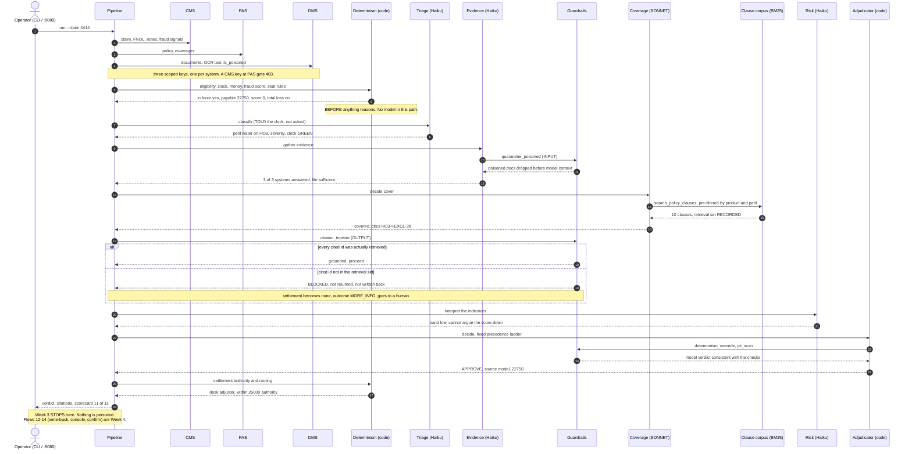

# Week 3 architecture — M3, the capability standalone

**Milestone.** *M3 — automated workflow in CI.* Gate: eval ≥ 0.9 with zero
adversarial failures. Sign-off: Lead Adjuster. See [`../week2/SOW.md`](../week2/SOW.md) §4.

[`../ARCHITECTURE.md`](../ARCHITECTURE.md) and
[`../week2/architecture.svg`](../week2/architecture.svg) describe the **end
state** — all fourteen flows, ClaimSense inside Northwind's workflow. This
document is the Week 3 subset, and the difference is the scope boundary.

**Week 3 is flows 1–11. Nothing writes back.**

---

## The shape

```
  ┌─ NORTHWIND MUTUAL ─ three vendors, three contracts, three credentials ─┐
  │   CMS                      PAS                      DMS               │
  │   claim · FNOL · notes     policy · coverages       documents · OCR    │
  │   fraud signals            clause corpus            is_poisoned flag   │
  └───────┬────────────────────────┬───────────────────────┬───────────────┘
        1 │                      2 │                     3 │   scoped key each
  ┌───────┴────────────────────────┴───────────────────────┴───────────────┐
  │ INTEGRATION LAYER   per-system scope · idempotency · audit             │
  │                     (RBAC and OAuth2 on-behalf-of land in Week 4)      │
  └────────────────────────────────┬──────────────────────────────────────-┘
                                 4 │ one claim bundle
  ┌────────────────────────────────┴───────────────────────────────────────┐
  │ ▣ DETERMINISTIC — settled BEFORE anything reasons          (flow 5)    │
  │   eligibility · clock · money · fraud score · seat rules               │
  │   no model in the path; test_boundary.py walks the AST to prove it     │
  ├────────────────────────────────────────────────────────────────────────┤
  │ ◆ MODEL JUDGMENT — strict typed output per stage      (flows 6-8,10-11) │
  │   Triage ─➜ Evidence ─➜ Coverage ─➜ Risk ─➜ Adjudicate                 │
  │   Haiku      Haiku       SONNET     Haiku     Haiku                    │
  │                            │ 9 search_policy_clauses (BM25, recorded)  │
  │   🛡 INPUT  quarantine poisoned docs before model context              │
  │   🛡 OUTPUT citation tripwire · determinism override · PII scan        │
  └────────────────────────────────┬───────────────────────────────────────┘
                                   │
                    ┌──────────────┴──────────────┐
                    │  CLI  ·  agent test client  │   ← the only consumers
                    │  make agent  ·  :8080       │      in Week 3
                    └─────────────────────────────┘

        ✗ flow 12  write-back into CMS            ─ Week 4
        ✗ flow 13  recommendation in Claims Desk  ─ Week 4
        ✗ flow 14  adjuster confirm / override    ─ Week 4
```

The recommendation is **returned and traced, not persisted**. That is the
boundary: Week 3 proves the capability; Week 4 puts it in someone's hands.

**Access control in Week 3 is rules, not RBAC.**
[`determinism/identity.py`](../../agent/src/claimsense_agent/determinism/identity.py)
answers two questions in code — may this seat *see* this claim (`can_view`, by
scope) and may it *confirm* a decision (`can_confirm`, which requires a
licence). Both are evaluated against a seat the caller **asserts** with
`--seat`. Nothing authenticates it. **RBAC proper — the boundary proving the
seat via OAuth2 on-behalf-of — is Week 4.** The rules are here so that when
real identity arrives there is something correct for it to feed.

---

## Flows

| # | Flow | Week 3 |
|---|---|---|
| 1–3 | Agent → CMS / PAS / DMS, one scoped key each | ✅ |
| 4 | Integration → pipeline, one claim bundle | ✅ |
| 5 | Deterministic facts — dates, money, score, seat rules | ✅ |
| 6–8, 10–11 | Stage outputs, strict typed dataclasses | ✅ |
| 9 | Coverage → clause corpus, retrieval set recorded | ✅ |
| 12 | Pipeline → CMS, the recommendation | ✗ Week 4 |
| 13 | CMS → console, `confirmed_by IS NULL` | ✗ Week 4 |
| 14 | Adjuster → CMS, confirm or override | ✗ Week 4 |

Flows 12 and 14 **exist in code and are tested**, held behind
`CLAIMSENSE_STAGE`, which defaults to `week3` — see
[`../../agent/src/claimsense_agent/stage.py`](../../agent/src/claimsense_agent/stage.py).
Building early is not a reason to claim a milestone early.

---

## What runs where

| Component | Technology | Entry point |
|---|---|---|
| Agent pipeline | Python 3.11, OpenAI Agents SDK 0.24 over LiteLLM → Bedrock | `pipeline.run_pipeline` |
| Judgment stages | Claude Haiku 4.5 ×4, Claude Sonnet 4.5 ×1 (coverage) | `agents/sdk_runtime.py` |
| Deterministic core | stdlib only, no model SDK importable | `determinism/` |
| Retrieval | hand-rolled BM25, no vector store (ADR-0005) | `retrieval/bm25.py` |
| Client systems | Next.js 14 + Zod contracts → PostgreSQL 16 | `platform/web/src/app/api/` |
| Orchestration | Docker Compose — db, seed, web | `docker compose up` |
| CI | GitHub Actions, `needs: [test, eval, integration]` | `.github/workflows/eval-gate.yml` |

**Two brains, one pipeline.** `pipeline.py:135` holds the only branch.
Everything downstream — guardrails, risk, adjudication, override, routing,
scorecard — runs identically whichever brain produced the stage outputs. The
mock brain is the CI brain: stdlib only, no key, no network, $0.

---

## The gate

```
pass rate      100%  (20/20)   threshold 90%
outcomes seen  {'APPROVE': 5, 'DENY': 8, 'MORE_INFO': 5, 'SIU_REFERRAL': 2}
adversarial    5/5 held
GATE PASSED
```

Three ways to fail: the rate, an outcome never produced, or any `ADV-*`
regression. It exits non-zero on each, and `build-and-push` declares
`needs: [test, eval, integration]` — a dependency, not a conditional.

## Status

**Complete and verified.** 328 tests pass; `./week3_demo.sh` exits 0; the live
Bedrock path runs under an EC2 instance role (`brain=llm`, `method=iam-role`).

---

## Sequence — one claim, end to end

Traced off [`pipeline.py`](../../agent/src/claimsense_agent/pipeline.py); the
section comments there match these steps in order.



**The two beats worth pausing on.** Step 6 is the whole architecture: the facts
are settled before any model runs, so the model is only ever *told* what the
clock and the money say. The `alt` block is the control in front of the money —
a claim that would have settled for $17,500 pays nothing and goes to a human.
