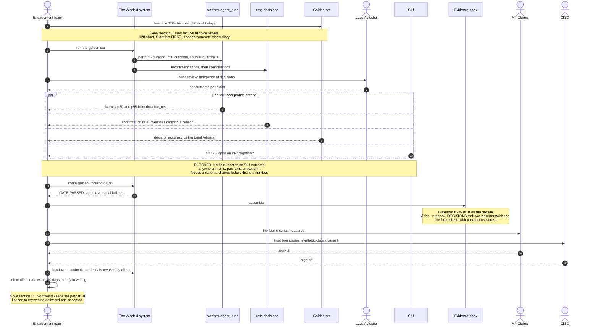

# Week 5 architecture — M5, prove and hand over

**Milestone.** *M5 — prove and hand over.* Gate: **golden ≥ 0.95 and the
evidence pack delivered.** Sign-off: VP Claims **and** CISO. See
[`../week2/SOW.md`](../week2/SOW.md) §4.

Week 5 adds **no new runtime flows.** The system is finished at Week 4; Week 5
is about proving it does what §3 of the SoW promised and handing over something
Northwind can own without us.

That makes this an architecture of **measurement**, not of components.

---

## The shape

```
   ┌──── the Week 4 system, running, unchanged ────┐
   │  flows 1-14 · MCP · RBAC at the boundary      │
   └──────────────────┬────────────────────────────┘
                      │ emits, per run
      ┌───────────────┴───────────────────────────────────┐
      │ platform.agent_runs                               │
      │   trace_id · claim_id · brain · outcome · source  │
      │   duration_ms · guardrails_fired · cited_clauses  │
      ├───────────────────────────────────────────────────┤
      │ cms.decisions                                     │
      │   confirmed_by · confirmed_at                     │
      │   override_outcome · override_reason              │
      └───────────────┬───────────────────────────────────┘
                      │ aggregated into
   ┌──────────────────┴────────────────────────────────────┐
   │ THE FOUR ACCEPTANCE CRITERIA  (SoW §3)                │
   │   decision accuracy   ≥ 92%  / ≥ 97% no-cover         │
   │   pipeline latency    p50 ≤ 60s · p95 ≤ 180s          │
   │   confirmation rate   ≥ 80% · 100% overrides reasoned │
   │   fraud routing       ≥ 70% precision · ≤ 5% miss     │
   └──────────────────┬────────────────────────────────────┘
                      │
   ┌──────────────────┴────────────────────────────────────┐
   │ EVIDENCE PACK + HANDOVER            (SoW §11)         │
   │   runbook · decision record · evidence pack           │
   │   credentials revoked · data deleted, certified 30d   │
   └───────────────────────────────────────────────────────┘
```

---

## Can each criterion actually be measured today?

Checked against the live schema, not against intent.

| Criterion | Substrate | Status |
|---|---|---|
| **Pipeline latency** p50/p95 | `platform.agent_runs.duration_ms` | ✅ measurable now |
| **Confirmation rate** ≥ 80%, overrides reasoned | `cms.decisions.confirmed_by` / `override_reason` | ✅ measurable once Week 4 lands |
| **Decision accuracy** ≥ 92% | golden suite is **22 cases**; SoW §3 specifies a **150-claim blind-reviewed set** | ⚠ **128 cases short** |
| **Fraud routing** precision / miss rate | needs "did SIU open an investigation" — **no such field exists anywhere in the schema** | ✗ **not measurable** |

### The two gaps, plainly

**The golden set is 22 cases, not 150.** `make golden` passes at 100% (22/22,
threshold 95%), so the *gate* is green — but the gate and the acceptance
criterion are not the same thing. §3 asks for 150 claims blind-reviewed by the
Lead Adjuster. Building 128 more synthetic claims is mechanical; getting them
blind-reviewed is calendar time and someone else's diary. **Start that first.**

**Fraud routing cannot be measured at all.** The criterion is SIU precision and
miss rate, which requires reconciling referrals against what SIU actually
opened. Nothing in `cms`, `pas`, `dms` or `platform` records an SIU outcome.
This needs a field and a reconciliation step before it is a number rather than
a promise. Of the four criteria this is the only one that is architecturally
blocked rather than merely unfinished.

### One documentation defect to fix with it

[`../week3/README.md:103`](../week3/README.md) states *"Per-run cost is recorded
in `platform.agent_runs`."* **It is not** — the table has no cost, token or
price column. Model routing is a priced deliverable (Sonnet on one stage,
Haiku on four), so if cost is to be claimed it has to be recorded. Either add
the column or drop the sentence; a cost control defended by a sentence is worse
than none.

---

## The evidence pack

Six artifacts already exist in [`../evidence/`](../evidence/) and are the
pattern to extend:

```
01-normal-run.txt                  04-deterministic-override.txt
02-blocked-by-tripwire.txt         05-eval-gate.txt
03-poisoned-document-quarantined.txt  06-golden-gate.txt
```

What M5 adds, per SoW §11: the **runbook** (how Northwind operates this without
us), the **decision record** (`DECISIONS.md`, 10 ADRs, already maintained), the
**two-adjuster confirmation evidence** from M4, and the four criteria measured
with their populations stated.

**The CISO signs this one.** That makes the trust-boundary section of
[`../ARCHITECTURE.md`](../ARCHITECTURE.md) and the synthetic-data invariant part
of the deliverable, not background: no production or personally identifiable
data at any stage, fixed seed, reserved `.invalid` / `.example` domains.

---

## Exit, by contract

On termination (SoW §11): client data and derived artifacts deleted within 30
days with deletion **certified in writing**; vendor credentials revoked by the
client; runbook, evidence pack and decision record handed over. Northwind
retains the perpetual licence in §6 to everything delivered and accepted.

> Working a claim by hand must still work in every stage. That is the Week 1
> capability and nothing in Weeks 3–5 may take it away.

## Status

Not started. Latency is measurable today, confirmation rate becomes measurable
when M4 lands, decision accuracy needs 128 more reviewed claims, and fraud
routing needs a schema change before it is measurable at all.

---

## Sequence — proving it, then handing it over

No new runtime interactions. This is the measurement and sign-off sequence, and
two of its steps are **blocked today** (marked below).



**Read the `par` block as the milestone.** Three of those four branches resolve
against data the system already emits. The fourth cannot resolve at all today,
and no amount of running the pipeline will change that — it is a missing field,
not a missing measurement.
